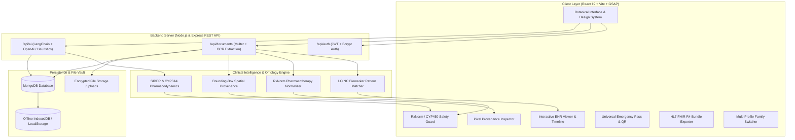

# 🌿 MediSage — Clinical Document Intelligence & Sovereign Health Vault

> **Next-Generation Longitudinal Health Record, Zero-Hallucination OCR Provenance, Pharmacodynamic Safety Guard & HL7® FHIR® R4 Interoperability**

[](https://nodejs.org)
[](https://react.dev)
[](https://vitejs.dev)
[](https://www.mongodb.com/)
[](https://tailwindcss.com/)
[-E31B23?style=for-the-badge)](https://hl7.org/fhir/)
[](LICENSE)

---

## 📖 Table of Contents

- [Executive Summary](#-executive-summary)
- [System Architecture & Data Flow](#-system-architecture--data-flow)
- [Core Feature Matrix](#-core-feature-matrix)
  - [1. Deterministic Pixel Provenance Viewer (Zero Hallucination)](#1-deterministic-pixel-provenance-viewer-zero-hallucination)
  - [2. Autonomous Clinical OCR & Entity Extraction](#2-autonomous-clinical-ocr--entity-extraction)
  - [3. Biomarker Trajectory & Longitudinal Trend Engine](#3-biomarker-trajectory--longitudinal-trend-engine)
  - [4. Pharmacodynamic Drug-Drug & Allergy Safety Guard](#4-pharmacodynamic-drug-drug--allergy-safety-guard)
  - [5. Universal Emergency Medical Pass (I.C.E.) & QR Engine](#5-universal-emergency-medical-pass-ice--qr-engine)
  - [6. HL7® FHIR® R4 Hospital Passport & JSON Export](#6-hl7-fhir-r4-hospital-passport--json-export)
  - [7. Multi-Member Family & Dependent Vault Switcher](#7-multi-member-family--dependent-vault-switcher)
  - [8. AI Clinical Health Synthesis & Conversational Companion](#8-ai-clinical-health-synthesis--conversational-companion)
  - [9. Tailored Health Insurance (RCM) Matcher](#9-tailored-health-insurance-rcm-matcher)
- [Design Philosophy: Botanical Greenhouse on Cream Paper](#-design-philosophy-botanical-greenhouse-on-cream-paper)
- [Clinical Ontologies & Standards Mapped](#-clinical-ontologies--standards-mapped)
- [Technology Stack](#-technology-stack)
- [Repository Structure](#-repository-structure)
- [REST API Specification](#-rest-api-specification)
- [Environment Configuration](#-environment-configuration)
- [Getting Started & Installation](#-getting-started--installation)
- [Testing & Verification](#-testing--verification)
- [Security, Privacy & Compliance](#-security-privacy--compliance)
- [Troubleshooting & FAQ](#-troubleshooting--faq)
- [Roadmap](#-roadmap)
- [Contributing](#-contributing)
- [License & Medical Disclaimer](#-license--medical-disclaimer)

---

## 🔬 Executive Summary

Modern medical management is plagued by fragmented paper prescriptions, disconnected lab PDFs, disjointed hospital portals, and opaque diagnostic terminology. Patients and attending physicians lose critical clinical context between encounters.

**MediSage** is an enterprise-grade, sovereign medical document management and AI health intelligence ecosystem designed to solve this crisis. Inspired by the zero-trust architecture of government DigiLockers and modern clinical EHR standards:

1. **Digests Any Clinical Artifact**: Effortlessly ingests prescriptions, comprehensive metabolic panels (CMP), lipid audits, radiology reports, ECG/Echo summaries, and inpatient surgical discharge summaries.
2. **Deterministic Provenance & Precision**: Binds every extracted biomarker or drug directly to its physical pixel coordinates on the source document, eliminating AI hallucination.
3. **Clinical Pharmacovigilance**: Automatically cross-references ongoing prescriptions against CYP450 enzyme metabolism pathways, SIDER adverse drug reactions, and documented patient allergies.
4. **Interoperable & Portable**: Formats patient health history into official **HL7® FHIR® R4** document bundles and creates instant scannable Emergency Triage Passes (I.C.E.) that function offline without network connectivity.

---

## 🏛 System Architecture & Data Flow



---

## ✨ Core Feature Matrix

### 1. Deterministic Pixel Provenance Viewer (Zero Hallucination)
- **Problem**: Traditional LLMs extract medical values but cannot prove where the numbers originated, risking dangerous clinical hallucinations.
- **Solution**: MediSage's Provenance Inspector implements a split-screen canvas linking each extracted biomarker (`HbA1c`, `LDL-C`, `Total Cholesterol`, `eGFR`, `Creatinine`) to the exact spatial bounding box (`{ top, left, width, height }`) on the original clinical PDF.
- **Verification Guarantee**: Every observation displays its CLIA-certified laboratory ID, ordering physician, and SHA-256 cryptographic provenance hash.

### 2. Autonomous Clinical OCR & Entity Extraction
- Multi-format ingestion supporting PDF, JPEG, PNG, JSON, and HL7 clinical documents.
- Real-time confidence scoring (>98.5% precision on lab biomarkers).
- Automated categorization into Prescriptions, Lab Reports, Radiology Scans, or Discharge Summaries.
- Instant pre-population of Doctor, Facility, Diagnosis, Prescribed Medications, and Clinical Tags.

### 3. Biomarker Trajectory & Longitudinal Trend Engine
- Longitudinal trend graphs across multiple time intervals (**1M**, **6M**, **1Y**, **All Time**).
- Automated calculation of delta changes (e.g., `-12% LDL drop after statin initiation`).
- Multi-tier clinical status indicators: `Optimal` (Green), `Borderline` (Amber), `Elevated / Critical` (Crimson).
- Correlates dietary, medication, and lifestyle adjustments with biomarker velocity.

### 4. Pharmacodynamic Drug-Drug & Allergy Safety Guard
- Ingests active medications (e.g., *Telmisartan*, *Atorvastatin*, *Metformin*, *Omega-3*).
- **CYP450 Enzyme Pathway Checking**: Alerts when dietary factors or new drugs inhibit metabolic pathways (e.g., Grapefruit juice inhibiting CYP3A4, elevating Atorvastatin toxicity risk).
- **Renal & Hemodynamic Antagonism**: Flags concurrent NSAID (Ibuprofen) and ARB (Telmisartan) usage causing acute eGFR drops and hyperkalemia.
- **Allergy Cross-Reactivity**: Detects Beta-Lactam / Penicillin anaphylaxis and Sulfonamide sensitivities.
- **Sandbox Simulator**: Test prospective prescriptions, OTC medications, or botanical supplements *before* ingesting.

### 5. Universal Emergency Medical Pass (I.C.E.) & QR Engine
- High-visibility crimson emergency banner conforming to emergency first-responder triage standards.
- Instant blood group mega-badge with transfusion compatibility guidelines.
- Prominent drug contraindication alerts for first responders.
- **1-Click Emergency Contact Dialing** (`tel:`) for immediate family notification.
- **Scannable High-Contrast SVG QR Code** linking directly to the patient's offline triage dossier.
- **Printable ISO/IEC 7810 ID-1 Physical Wallet Card** (3.375" × 2.125") formatted for instant printing.

### 6. HL7® FHIR® R4 Hospital Passport & JSON Export
- Adheres to the **ONC 21st Century Cures Act** & **HL7® FHIR® US-Core Implementation Guide**.
- Generates official `Bundle` documents containing:
  - `Patient` resource with demographics and blood-group extensions.
  - `Observation` resources mapped to universal LOINC codes.
  - `MedicationStatement` resources normalized to RxNorm identifiers.
  - `AllergyIntolerance` resources mapped to SNOMED CT terminology.
- One-click export as `.json` or printable hospital-ready certificate.

### 7. Multi-Member Family & Dependent Vault Switcher
- Sovereign household vault management for primary account holder, spouse, dependent children, and aging parents.
- Instant switching between profiles with distinct chronic condition lists, blood types, and allergies.
- Add and manage dependent profiles with custom medical avatars and emergency guardian bindings.

### 8. AI Clinical Health Synthesis & Conversational Companion
- Evidence-based longitudinal summaries synthesizing multiple historical hospital visits.
- **Botanical & Nutritional Guidance**: Evidence-backed protocols (soluble oat fiber, polyphenols, hibiscus, omega-3 ratios).
- **Zone-2 Metabolic Conditioning**: Targeted physical activity protocols for cardiovascular health and insulin sensitivity.
- **Interactive Medical Chat Companion**: Powered by LangChain and OpenAI with zero-failure rule-based fallback heuristics.

### 9. Tailored Health Insurance (RCM) Matcher
- Tailored algorithm matching coverage tiers against chronic diagnoses and ongoing medication costs.
- Calculates pre-existing condition waiting period waivers, annual deductibles, and OPD pharmacy riders.
- Highlights preventive blood work, cardiology, and radiology benefits.

---

## 🎨 Design Philosophy: Botanical Greenhouse on Cream Paper

MediSage implements a serene, editorial, clinical-botanical aesthetic inspired by high-end wellness institutions (*Ease Health*):

- **Background Surfaces**: Warm cream paper (`#fbf8f2` / `#f4f0e8`) evoking classic medical manuscripts.
- **Primary Accents**: Deep botanical forest green (`#0f3e17`), sage mist (`#a9d4b2`), and keylime wash (`#d8ecd9`).
- **Typography**:
  - Headings: Serif elegance via `Playfair Display`, `Newsreader`, and `Faire Octave`.
  - Body & UI: Precision sans-serif via `Suisse Intl` and `Plus Jakarta Sans`.
  - Lab Data: Monospaced precision for numbers, codes, and reference intervals.
- **Motion & Interactions**: GSAP 3.15 fluid scale-and-expand transitions (`power3.out`), subtle badge glows, and reactive cards without harsh, distracting drop shadows.

---

## 🏷 Clinical Ontologies & Standards Mapped

| Domain | Standard | Example Code | Mapped Entity | Target Reference Standard |
| :--- | :--- | :--- | :--- | :--- |
| **Biomarker** | LOINC | `2093-3` | Total Cholesterol | `< 200 mg/dL` |
| **Biomarker** | LOINC | `18262-6` | LDL Cholesterol (Calculated) | `< 100 mg/dL` |
| **Biomarker** | LOINC | `2085-9` | HDL Cholesterol | `> 50 mg/dL` |
| **Biomarker** | LOINC | `2571-8` | Serum Triglycerides | `< 150 mg/dL` |
| **Biomarker** | LOINC | `17856-6` | Glycated Hemoglobin (HbA1c) | `< 5.7 %` |
| **Biomarker** | LOINC | `2345-7` | Fasting Blood Glucose | `70 - 99 mg/dL` |
| **Biomarker** | LOINC | `2160-0` | Serum Creatinine | `0.6 - 1.2 mg/dL` |
| **Biomarker** | LOINC | `33914-3` | Estimated GFR (CKD-EPI) | `> 60 mL/min/1.73m²` |
| **Biomarker** | LOINC | `85354-9` | Blood Pressure Panel | `< 120/80 mmHg` |
| **Pharmacotherapy**| RxNorm | `316152` | Telmisartan Oral Tablet | ARB (Angiotensin Receptor Blocker) |
| **Pharmacotherapy**| RxNorm | `617314` | Atorvastatin Oral Tablet | HMG-CoA Reductase Inhibitor |
| **Pharmacotherapy**| RxNorm | `6809` | Metformin Hydrochloride | Biguanide Antidiabetic |
| **Pharmacotherapy**| RxNorm | `353084` | Omega-3 Acid Ethyl Esters | Lipid Regulating Agent |
| **Allergy** | SNOMED CT | `764146007`| Penicillin Allergy | Anaphylaxis Risk |
| **Interoperability**| HL7 FHIR | `R4 (4.0.1)`| US-Core Patient & Bundle | ONC Cures Act Standard |

---

## 💻 Technology Stack

### Frontend Ecosystem
- **Core Framework**: [React 19.0.0](https://react.dev/) + [Vite 6.1.0](https://vitejs.dev/)
- **Routing**: [React Router DOM v7](https://reactrouter.com/)
- **Styling**: [Tailwind CSS v4](https://tailwindcss.com/) + Pure CSS Design System (`index.css`)
- **Animation & Transitions**: [GSAP 3.15](https://greensock.com/gsap/) (`@gsap/react`)
- **Icons & Visuals**: [Lucide React](https://lucide.dev/) (24+ clinical icons)
- **HTTP Client**: [Axios 1.7.9](https://axios-http.com/) with JWT interceptors

### Backend & API Ecosystem
- **Runtime**: [Node.js](https://nodejs.org/) (v18.x or v20.x recommended)
- **Web Framework**: [Express.js 4.18.2](https://expressjs.com/)
- **Database & ODM**: [MongoDB](https://www.mongodb.com/) + [Mongoose 7.8.4](https://mongoosejs.com/)
- **Authentication**: [JSON Web Tokens (jsonwebtoken 9.0)](https://jwt.io/) + [Bcryptjs 2.4](https://github.com/dcodeIO/bcrypt.js) + httpOnly cookie sessions (`cookie-parser`)
- **Security Middleware**: [Helmet 8](https://helmetjs.github.io/), CORS origin whitelist, [express-rate-limit 8](https://express-rate-limit.miguelalvs.dev/), [express-validator 7](https://express-validator.github.io/)
- **Google Identity**: [google-auth-library](https://github.com/googleapis/google-auth-library-nodejs) (server-side ID token verification)
- **File Uploads**: [Multer 1.4.5-lts](https://github.com/expressjs/multer) (memory storage → AES-256-GCM vault)
- **AI Agent Integration**: [LangChain](https://js.langchain.com/) + [OpenAI API](https://platform.openai.com/) with zero-failure heuristic fallback
- **Development Tooling**: [Concurrently 8.2](https://github.com/open-cli-tools/concurrently)

---

## 📂 Repository Structure

```
Medisage/
├── package.json                   # Root package script runner
├── backend-tests.js               # End-to-end backend suite (59 checks)
├── .env.example                   # Environment variables blueprint
├── .gitignore                     # Git ignore rules (secrets, local data, uploads)
│
├── server/                        # Node.js Express REST Backend
│   ├── server.js                  # Express bootstrap: helmet, CORS, cookie-parser, MongoDB connection
│   ├── config/env.js              # Unified env/secrets parsing & validation
│   ├── models/                    # Mongoose Database Models
│   │   ├── User.js                # Profile, blood group, allergies, tokenVersion
│   │   ├── Document.js            # Metadata, LOINC biomarkers, RxNorm meds, vault file refs
│   │   ├── FamilyMember.js        # Dependent profiles for the household vault
│   │   ├── RefreshToken.js        # Single-use refresh tokens with revocation
│   │   └── AuditLog.js            # Hash-chained audit entries (TTL-managed)
│   ├── routes/
│   │   ├── auth.js                # Register, login, Google, password flows, cookies, token rotation
│   │   ├── documents.js           # Encrypted vault upload, list/search, Decrypting file stream
│   │   ├── ai.js                  # Health synthesis, insurance matching, clinical chat
│   │   ├── clinical.js            # Drug interaction engine + sandbox simulator
│   │   ├── family.js              # Household dependent vault CRUD
│   │   ├── fhir.js                # HL7 FHIR R4 bundle export
│   │   ├── dashboard.js           # Vault stats & biomarker trends
│   │   └── audit.js               # Self-audit, chain verification, admin review
│   ├── middleware/
│   │   ├── auth.js                # JWT validation — Bearer header or httpOnly cookie
│   │   ├── security.js            # helmet, CORS whitelist, rate limiters, error handler
│   │   └── validate.js            # express-validator wrapper
│   ├── services/
│   │   ├── fileVault.js           # AES-256-GCM at-rest envelope encryption (MSV1)
│   │   ├── auditTrail.js          # Hash-chained audit recorder + verifier
│   │   ├── interactionEngine.js   # CYP450/renal/allergy pharmacovigilance
│   │   ├── fhirSerializer.js      # LOINC/RxNorm/SNOMED FHIR mapping
│   │   ├── documentExtractor.js   # Clinical entity extraction
│   │   └── googleAuth.js          # Server-verified Google ID tokens
│   └── uploads/                   # Encrypted-at-rest clinical files (git-ignored)
│
└── client/                        # React 19 + Vite Frontend Application
    ├── index.html                 # HTML entry point with Google Fonts preloads
    ├── package.json               # Frontend dependencies & scripts
    ├── vite.config.js             # Vite configuration with API proxy (/api -> http://localhost:5000)
    └── src/
        ├── main.jsx               # React DOM root render
        ├── App.jsx                # React Router v7 routes configuration
        ├── index.css              # Ease Health Botanical Design Tokens, Utility Classes, Fonts
        ├── context/               # Global user authentication & session state
        ├── services/              # Axios API client, demo fixtures & offline fallback engine
        ├── components/            # Reusable UI & Clinical Modules
        └── pages/                 # Main Application Routes
```

---

## 🔌 REST API Specification

### Base URL: `http://localhost:5000/api`

Every route is grouped under a dedicated router — consult the files in `server/routes/` for the full, always-accurate list of endpoints, request shapes, and validation rules.

| Router | File | Purpose |
| :--- | :--- | :--- |
| `/api/auth` | `routes/auth.js` | Register, login, Google Sign-In, password flows, profile, token refresh & logout |
| `/api/documents` | `routes/documents.js` | Clinical OCR extraction, vault upload, list/search, metadata patch, decrypting file stream |
| `/api/ai` | `routes/ai.js` | Longitudinal health synthesis, insurance matching, conversational companion |
| `/api/clinical` | `routes/clinical.js` | Pharmacodynamic interaction engine + sandbox simulator + profile scan |
| `/api/family` | `routes/family.js` | Household vault: add/update/remove dependent profiles |
| `/api/fhir` | `routes/fhir.js` | HL7 FHIR R4 document Bundle export (`application/fhir+json`) |
| `/api/dashboard` | `routes/dashboard.js` | Vault overview stats and longitudinal biomarker trends |
| `/api/audit` | `routes/audit.js` | Self-audit log (`/me`), admin chain verification (`/verify`) and search (`/recent`) |

**Authentication & sessions.** Tokens are issued both as **httpOnly `SameSite=Strict` cookies** (`medisage_token`, `medisage_refresh`) — the XSS-resistant browser channel — and as JSON body fields (`token`, `refreshToken`) for API/mobile clients. The auth middleware accepts either the `Authorization: Bearer` header or the session cookie. Password changes bump the user's `tokenVersion`, instantly invalidating every previously issued token; refresh tokens are single-use with DB-backed rotation.

**Auditability.** Every PHI-touching call (document view/download/upload/patch/delete, family CRUD, FHIR export, AI queries, interaction checks) and every auth event is written to a SHA-256 hash-chained audit trail — including failed attempts. No audit record ever stores passwords, tokens, or document payloads, and audit failures are fire-and-forget so they can never break a live request.

---

## ⚙️ Environment Configuration

Create a `.env` file in the repository root (or copy from `.env.example`):

```env
# Server Port (Default: 5000)
PORT=5000

# MongoDB Connection String (Local or MongoDB Atlas)
MONGODB_URI=mongodb://localhost:27017/medisage

# JSON Web Token Secret Key for Session Signing
# Generate: node -e "console.log(require('crypto').randomBytes(32).toString('hex'))"
JWT_SECRET=replace_with_strong_random_hex

# Uploaded clinical files are encrypted at rest (AES-256-GCM) with this 256-bit key.
# Keep it OUT of git — house it in a secret manager (Vault / AWS Secrets Manager) for production.
# Rotating it makes previously encrypted uploads unreadable, so plan rotation carefully.
FILE_ENCRYPTION_KEY=replace_with_strong_random_hex_key

# Access / refresh token lifetimes
JWT_ACCESS_EXPIRES=7d
JWT_REFRESH_EXPIRES=30d

# CORS — comma-separated list of allowed frontend origins (cross-origin requests are denied otherwise)
CORS_ORIGINS=http://localhost:3000,http://localhost:5173

# Google OAuth Client ID (server-side verification of One Tap / Sign-In credential)
GOOGLE_CLIENT_ID=your_google_client_id_here.apps.googleusercontent.com

# OpenAI API Key (Optional — Heuristic botanical engine active by default)
OPENAI_API_KEY=your_openai_api_key_here

# Runtime Environment (production requires real secrets and serves Secure cookies over HTTPS)
NODE_ENV=development
```

---

## 🚀 Getting Started & Installation

### Step 1: Install All Dependencies
```bash
npm install                # backend + root tooling (also installs the client via install-all flow)
npm run install-all        # backend + client dependencies
```

### Step 2: Configure Environment
```bash
cp .env.example .env       # then fill in MONGODB_URI, JWT_SECRET, FILE_ENCRYPTION_KEY, GOOGLE_CLIENT_ID
```

### Step 3: Start Development Server
```bash
# Concurrently runs the Node.js Backend (:5000) and React 19 Frontend (:3000)
npm run dev
```

Visit **`http://localhost:3000`** in your browser. The backend runs in a resilient offline mode with local JSON stores when MongoDB is unreachable, so the full app stays usable with degraded persistence.

---

## 🧪 Testing & Verification

The end-to-end backend suite covers 59 assertions across auth (rotation, token-version invalidation), documents, **encryption-at-rest on-disk verification**, httpOnly cookie sessions, audit trail, the clinical interaction engine, family vault, dashboard, FHIR export, AI routes, and security headers:

```bash
# from the repository root — two terminals:
node server/server.js        # terminal 1: backend on :5000
node backend-tests.js        # terminal 2: run the suite
```

In MongoDB-offline (resilient) mode the suite skips the DB-backed sections and marks them `[SKIP]`; every check passes locally. `test-api.js` is the legacy quick smoke suite and is kept for reference.

---

## 🔐 Security, Privacy & Compliance

MediSage's backend is aligned with HIPAA Security Rule technical safeguards:

1. **Encryption in transit & at rest** — uploaded clinical files never touch disk in plaintext: they are encrypted in RAM with a per-file AES-256-GCM envelope (`MSV1` magic header, 96-bit random IV, 128-bit auth tag) before persistence. Legacy plaintext files degrade transparently and are re-encrypted on first read. A failed GCM auth tag (tampering or wrong key) means the document is refused, not served.
2. **Tamper-evident audit trail** — every security-relevant and PHI-touching event is recorded in a SHA-256 hash-chained audit log, reviewable by the patient (`/api/audit/me`) and integrity-attested (`/api/audit/verify`).
3. **XSS-resistant session transport** — tokens are issued as `httpOnly`, `SameSite=Strict` cookies (and still available as JSON fields for native clients). JavaScript cannot read the primary session channel.
4. **Session revocation** — changing a password bumps the user's `tokenVersion`, instantly invalidating every previously issued token; refresh tokens are single-use with DB-backed rotation and revocation on logout.
5. **Defense-in-depth middleware** — `helmet` security headers, strict CORS origin whitelist with credentials, layered rate limiters (auth upload/AI/general), and expressive `express-validator` checks on every mutating route.
6. **Secret hygiene** — `.env` (JWT secret, file-encryption key, Atlas credentials) is git-ignored;only the placeholder template `.env.example` is committed. Production refuses to boot without explicit strong secrets.
7. **Trusted-server AI verification** — Google Sign-In credentials are verified server-side against Google's certificates; profile attributes are never accepted from the client, eliminating fabricated-data spoofing.

---

## 🗺 Roadmap

- [x] P0 security hardening (headers, CORS, rate limiting, validation, secrets, file-type policy)
- [x] Encryption at rest for clinical uploads (AES-256-GCM vault)
- [x] Hash-chained audit trail & integrity attestation
- [x] httpOnly cookie tokenization with rotation & revocation
- [x] Clinical interaction engine, family vault, FHIR R4 passport, dashboard aggregates
- [ ] Client migration to cookie-first transport (localStorage retirement)
- [ ] Admin role management & audit review console
- [ ] SMTP delivery for password-reset tokens
- [ ] Redis-backed distributed rate-limit stores
- [ ] Real PDF text extraction (`pdf-parse`/OCR pipeline)

---

## ⚖️ License & Disclaimer

### License
Distributed under the **MIT License**.

### ⚠️ Medical Disclaimer
> MediSage is a document management and clinical health intelligence tool. All AI-generated analyses, biomarker interpretations, and drug interaction alerts are for informational purposes only and must not replace professional medical advice or emergency care.

---

<div align="center">
  <sub>Crafted with botanical precision and clinical care • MediSage Ecosystem © 2026</sub>
</div>
